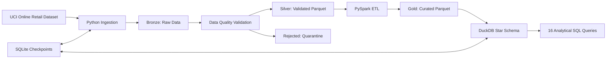

# Retail Data Infrastructure & Analytics Platform

An end-to-end data engineering platform built using Python, PySpark, DuckDB, SQLite, and SQL on the UCI Online Retail dataset containing **541,909 transactions**.

The platform implements automated ETL pipelines, data-quality validation, incremental processing, late-arriving data handling, a Parquet-based data lake, and a dimensional data warehouse.

## Architecture



## Technology Stack

- **Programming:** Python 3.12, SQL
- **Data Processing:** PySpark, Pandas, NumPy
- **Storage:** Apache Parquet, SQLite
- **Data Warehouse:** DuckDB
- **Data Engineering:** ETL, incremental ingestion, data validation, deduplication, idempotency, late-arriving data processing
- **Testing:** pytest
- **Cloud Infrastructure Artifacts:** AWS S3, Glue, Lambda, IAM, Redshift, CloudFormation

## Key Features

- End-to-end ETL pipeline with Bronze, Silver, Rejected, and Gold data zones.
- Automated data-quality checks and invalid-record quarantine.
- SHA-256-based record identification and duplicate detection.
- Incremental ingestion with SQLite watermarks and checkpoints.
- Idempotent processing and late-arriving data handling.
- Partitioned Parquet storage using PySpark.
- DuckDB dimensional data warehouse with a five-table star schema.
- Analytical SQL covering customer segmentation, cohort analysis, revenue trends, and product performance.
- Automated testing and structured logging.

## Dataset

**Source:** [UCI Machine Learning Repository – Online Retail](https://archive.ics.uci.edu/dataset/352/online+retail)

- Raw transactions: 541,909
- Invoices: 25,900
- Stock codes: 4,070
- Customer IDs: 4,372
- Countries: 38

Daily batches and late-arriving records are simulated deterministically from the historical transaction dates. No synthetic transactions are introduced.

## Verified Results

| Metric                        |  Result |
| ----------------------------- | ------: |
| Total records processed       | 541,909 |
| Valid records                 | 534,135 |
| Quarantined records           |   7,774 |
| Data-quality pass rate        |  98.57% |
| Unique warehouse transactions | 534,128 |
| Analytical SQL queries        |      16 |
| Automated tests passed        |   11/11 |

### Revenue Reconciliation

| Metric            |        Amount |
| ----------------- | ------------: |
| Gross Revenue     | 10,631,048.74 |
| Cancelled Revenue |    893,979.73 |
| Net Revenue       |  9,737,069.01 |

### Data Warehouse

Implemented a five-table dimensional star schema:

- `fact_sales`
- `dim_customer`
- `dim_product`
- `dim_date`
- `dim_country`

Additional batch audit tracking is maintained through `etl_batch_audit`.

## Analytical SQL

The project includes 16 analytical queries covering:

- Monthly revenue trends
- Top products and country revenue contribution
- Customer RFM segmentation
- Customer lifetime value
- Cohort retention analysis
- Cancellation analysis
- Rolling seven-day revenue
- Basket size and average order value
- Repeat versus one-time customers
- Pareto 80/20 product analysis
- Late-arriving data and batch auditing

SQL scripts are available in `sql/analytics/`.

## Getting Started

### Prerequisites

- Python 3.10+
- Java 17+
- Git

### Installation

```bash
git clone <repository-url>
cd retail-data-infrastructure-analytics
python -m pip install -r requirements.txt
```

For Windows PySpark Parquet operations, `winutils.exe` and `hadoop.dll` may also be required.

### Run the Pipeline

```bash
python scripts/download_dataset.py
python scripts/prepare_batches.py
python scripts/run_pipeline.py --mode all
python scripts/run_analytics.py
```

### Run Tests

```bash
python -m pytest
```

## AWS Implementation Status

AWS deployment artifacts have been prepared for:

- Amazon S3
- AWS Glue and Glue Data Catalog
- AWS Lambda
- IAM policies
- Amazon Redshift
- AWS CloudFormation

**Deployment status:** AWS resources have not been deployed. The verified implementation currently runs locally.

See `docs/aws_deployment_guide.md` for deployment documentation.

## Project Documentation

- `docs/architecture.md` – System architecture
- `docs/data_quality_report.md` – Data-quality results
- `docs/warehouse_schema.md` – Warehouse schema
- `docs/aws_deployment_guide.md` – AWS deployment guidance

---

## Copyright & Usage

Copyright © 2026 Rashmita Perumanla. All rights reserved.

This repository and its contents are proprietary intellectual property.

No permission is granted to use, copy, modify, reproduce, distribute, or commercially exploit any part of this project without prior written permission from the copyright holder.

Unauthorized use is prohibited.

