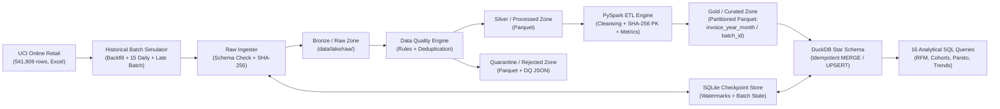

# Retail Data Infrastructure & Analytics Platform

An end-to-end, production-inspired data engineering platform built on the official **UCI Online Retail** transactional dataset (`541,909` raw records). The system ingests daily simulated batches, enforces automated data-quality validation and quarantine, transforms data using **PySpark** into a Medallion-style **Parquet** data lake, tracks watermarks and checkpoints for idempotent incremental and late-arriving processing, loads a **DuckDB** dimensional Star Schema warehouse, and executes **16 analytical SQL queries**.

All AWS deployment artifacts (**S3**, **AWS Glue 4.0**, **Glue Data Catalog**, **AWS Lambda**, **IAM**, **Amazon Redshift**, and **CloudFormation**) are prepared and documented alongside the verified local implementation.

---

## Business Problem

Multi-country e-commerce operations generate noisy transactional logs containing cancelled invoices, guest checkouts without customer identifiers, duplicate POS submissions, zero-price promotional entries, non-merchandise service fees (`POST`, `D`, `BANK CHARGES`), and out-of-order late-arriving records. Without automated quality gates, idempotent incremental loading, and dimensional modeling, downstream financial reporting, cohort retention, and customer lifetime value (CLV) analytics silently double-count revenue or drop ~25% of guest transactions.

---

## System Architecture



See [`docs/architecture.md`](docs/architecture.md) for both local and AWS cloud-ready architecture diagrams.

---

## Technology Stack

- **Core Languages**: Python 3.12, SQL
- **Distributed Processing**: PySpark 4.3.0 (local mode with OpenJDK 17)
- **Data Lake & Storage**: Apache Parquet (Snappy compression, Hive-style partitioning), Pandas, PyArrow
- **Local Analytical Warehouse**: DuckDB 2.0.0 (`analytics` Star Schema)
- **Operational State & Resilience**: SQLite checkpoint/watermark store, Pydantic v2 settings, Tenacity exponential-backoff retries, structured JSON/console logging
- **Testing**: `pytest`
- **Cloud-Ready IaC & Scripts (Prepared, Not Deployed)**: AWS CloudFormation, Amazon S3, AWS Glue 4.0, AWS Glue Data Catalog, AWS Lambda, IAM least-privilege policies, Amazon Redshift

---

## Dataset Source & Real Profile

- **Official Source**: [UCI Machine Learning Repository — Online Retail Dataset (ID 352)](https://archive.ics.uci.edu/dataset/352/online+retail)
- **File Inspected**: `Online Retail.xlsx`
- **Date Range**: `2010-12-01 08:26:00` to `2011-12-09 12:50:00`
- **Total Raw Rows**: `541,909`
- **Distinct Raw Cardinality**: `25,900` invoices | `4,070` stock codes | `4,372` customer IDs | `38` countries
- **Observed Raw Anomalies**:
  - Missing `CustomerID`: `135,080` rows (`24.93%`)
  - Missing `Description`: `1,454` rows (`0.27%`)
  - Exact duplicate excess rows: `5,268` (`10,147` rows involved in duplicate groups)
  - Cancelled invoices (`C` prefix): `9,288` rows
  - Non-standard invoice numbers (bad-debt adjustments `A563185`–`A563187`): `3` rows
  - Negative quantities without `C` prefix: `1,336` rows
  - Non-positive `UnitPrice` (`<= 0`): `2,517` rows (`2,515` zero + `2` negative)

### Historical-Data Simulation Design

To replicate daily production operations without fabricating transactions, `scripts/prepare_batches.py` deterministically slices `Online Retail.xlsx` along `InvoiceDate` (`simulation_mode: "historical_data_simulation"`):
1. `batch_0001_historical_backfill.csv` (`491,984` rows: `2010-12-01` to `2011-11-22`)
2. `batch_0002_daily_2011-11-23.csv` through `batch_0016_daily_2011-12-09.csv` (15 daily incremental batches)
3. `batch_9999_late_arriving.csv` (`250` real mid-year records held back and delivered out-of-order after the high watermark reaches `2011-12-09`)

Total batched rows = `541,909` (100% conservation).

---

## Installation & Setup

### Prerequisites
- Python `>= 3.10` (verified on Python `3.12.0`)
- Java 17+ (`JAVA_HOME` configured, or place portable OpenJDK 17 in `.tools/jdk/`)
- On Windows for local PySpark Parquet writes: `winutils.exe` and `hadoop.dll` in `.tools/hadoop/bin/` (or `%HADOOP_HOME%\bin`)
- Git

### Install Dependencies

```bash
python -m pip install -r requirements.txt
cp .env.example .env
```

---

## Execution Instructions

Run the complete local workflow end-to-end:

```bash
# 1. Download official UCI Online Retail dataset
python scripts/download_dataset.py

# 2. Profile raw dataset statistics -> data/reports/raw_dataset_profile.json
python scripts/inspect_dataset.py

# 3. Generate reproducible historical simulation batches (17 batches, 541,909 rows)
python scripts/prepare_batches.py

# 4. Run full pipeline (Bronze -> DQ/Silver/Rejected -> PySpark Gold -> DuckDB Warehouse)
python scripts/run_pipeline.py --mode all

# 5. Re-run to verify idempotent duplicate-batch skipping
python scripts/run_pipeline.py --mode all

# 6. Execute all 16 analytical SQL queries -> data/reports/sql_outputs/
python scripts/run_analytics.py

# 7. Run automated pytest suite
python -m pytest
```

Single-step / targeted modes:
```bash
python scripts/run_pipeline.py --mode backfill
python scripts/run_pipeline.py --mode incremental
python scripts/run_pipeline.py --mode late-arriving
python scripts/run_pipeline.py --mode batch --batch-file data/batches/batch_9999_late_arriving.csv --batch-id batch_9999_late_arriving --force
```

---

## Pipeline Architecture & Reliability Features

- **Medallion Data Lake (`data/lake/`)**:
  - `raw/`: Immutable ingested batch CSVs + `_ingestion_metadata.json` with SHA-256 checksums.
  - `processed/` (Silver): Validated batch Parquet files.
  - `rejected/` (Quarantine): Invalid records with primary `rejection_reason` + pipe-delimited `rejection_rules_all` + `_quality_summary.json`.
  - `curated/` (Gold): PySpark-cleansed transactions partitioned by `(invoice_year_month, batch_id)` plus global Gold summary tables (`gold_monthly_country_summary`, `gold_product_performance`, `gold_customer_summary`).
- **Incremental & Idempotent Execution**:
  - SQLite `CheckpointStore` (`data/state/pipeline_state.sqlite`) tracks `batch_registry`, `step_checkpoints`, and monotonic `watermarks`.
  - Duplicate runs with matching `batch_id` / `file_sha256` are skipped cleanly.
  - Forced reruns overwrite only that batch's dynamic Parquet partitions and execute transactional `INSERT ... ON CONFLICT (transaction_line_id) DO UPDATE` in DuckDB.
- **Late-Arriving Data Handling**:
  - Incoming batches with `min_invoice_ts < high_watermark_ts` are flagged `is_late_arriving = true`, written to historical `invoice_year_month` Parquet partitions, upserted into `fact_sales` and dimensions (`first_purchase_ts = LEAST(...)`), and never regress `high_watermark_ts` (`2011-12-09 12:50:00`).

---

## Data-Quality Results (Verified Execution)

From [`docs/data_quality_report.md`](docs/data_quality_report.md) across all 17 batches (`541,909` raw rows):

| Metric | Count |
| --- | ---: |
| Total Raw Rows Processed | 541,909 |
| Valid Rows Passed to Silver | 534,135 (98.57%) |
| Quarantined Rows (Rejected Zone) | 7,774 |
| — `DQ_EXACT_DUPLICATE` (primary) | 5,256 |
| — `DQ_NON_POSITIVE_UNIT_PRICE` (primary) | 2,515 |
| — `DQ_NON_STANDARD_INVOICE` (primary) | 3 |
| Cross-Batch Exact Duplicates Deduplicated in Warehouse | 7 |
| **Unique Valid Transactions Loaded in `fact_sales`** | **534,128** |

---

## Warehouse Star Schema & Verified Analytical Results

DuckDB database (`data/warehouse/retail_warehouse.duckdb`, schema `analytics`):
- **`analytics.fact_sales`**: `534,128` rows | Gross Revenue: `10,631,048.74` | Cancelled Revenue: `893,979.73` | Net Revenue: `9,737,069.01`
- **`analytics.dim_customer`**: `4,372` rows (`4,371` identified + `customer_key = -1` for `GUEST`)
- **`analytics.dim_product`**: `3,827` rows (`3,818` merchandise SKUs + `9` non-product service/fee codes)
- **`analytics.dim_date`**: `305` calendar dates
- **`analytics.dim_country`**: `38` countries
- **`analytics.etl_batch_audit`**: `17` batch audit records

Full ERD and grain documentation: [`docs/warehouse_schema.md`](docs/warehouse_schema.md).

### Sample Verified SQL Insights (`sql/analytics/`)

- **Country Concentration (`03_country_revenue_share.sql`)**: United Kingdom accounts for `83.99%` (`8,178,190.24`), followed by Netherlands (`2.92%` / `284,661.54`) and EIRE (`2.70%` / `262,993.38`).
- **Pareto 80/20 (`15_pareto_80_20_product_revenue.sql`)**: `21.90%` of merchandise SKUs (`831` SKUs) generate `79.98%` (`7,821,774.70`) of positive product revenue.
- **Top Product (`02_top_products_by_revenue.sql`)**: `22423` (`REGENCY CAKESTAND 3 TIER`) generated `164,459.49` net revenue across `1,988` orders.
- **RFM Segmentation (`04_customer_rfm_segmentation.sql`)**: `470` `Champions` customers (avg recency `5.9` days, avg `15.75` orders) drive `4,230,426.09` in net spend.
- **Cancellation Impact (`07_cancellation_impact_on_revenue.sql`)**: Average monthly cancellation impact is `9.25%` of gross revenue, peaking in `2011-01` at `19.04%` (`131,363.05`).

---

## Testing Results

Executed `python -m pytest` across all unit and integration suites (`11 passed` in `78.06s`):
- `tests/test_ingestion.py` (4 tests): schema check, empty-file rejection, metadata creation, SHA-256 duplicate skipping
- `tests/test_validation.py` (2 tests): DQ rule partitioning, quarantine Parquet & consolidated report generation
- `tests/test_transformation_spark.py` (1 test): PySpark transformations, cancellation/guest flags, partitioned Parquet, Gold aggregates
- `tests/test_incremental_and_idempotency.py` (1 test): incremental load, duplicate skip, forced rerun zero-duplicate guarantee
- `tests/test_late_arriving_data.py` (1 test): late-arrival detection, non-regressing watermark, historical partition backfill, `first_purchase_ts` update
- `tests/test_warehouse.py` (1 test): star schema FK integrity, `GUEST` `-1` key, batch audit
- `tests/test_analytics_sql.py` (1 test): automated execution of all 16 analytical SQL scripts

---

## Implementation Status Separation

### 1. Locally Implemented & Verified
- Complete Python + PySpark + Parquet + SQLite checkpoint + DuckDB warehouse pipeline verified end-to-end on all `541,909` UCI records.
- All 16 analytical SQL queries executed and exported to CSV/JSON.
- Automated `pytest` suite (`11/11` passing).

### 2. AWS Configurations Prepared (Not Deployed)
- [`infrastructure/aws/cloudformation/retail_platform_stack.yaml`](infrastructure/aws/cloudformation/retail_platform_stack.yaml)
- [`infrastructure/aws/glue_jobs/bronze_to_silver_dq.py`](infrastructure/aws/glue_jobs/bronze_to_silver_dq.py) & [`silver_to_gold_curated.py`](infrastructure/aws/glue_jobs/silver_to_gold_curated.py)
- [`infrastructure/aws/lambda/ingestion_trigger/handler.py`](infrastructure/aws/lambda/ingestion_trigger/handler.py)
- [`infrastructure/aws/iam/`](infrastructure/aws/iam/) least-privilege policies
- [`infrastructure/aws/redshift/`](infrastructure/aws/redshift/) DDL and S3 `COPY` + `MERGE` scripts
- Deployment & cost guide: [`docs/aws_deployment_guide.md`](docs/aws_deployment_guide.md)

### 3. AWS Components Deployed
- **None** — no live AWS resources were provisioned in order to avoid unauthorized cloud charges.

---

## Known Limitations & Future Improvements

- **Historical Simulation vs Live CDC**: Daily incremental and late-arriving batches are simulated chronologically from historical UCI `InvoiceDate` values rather than a live message broker.
- **Pandas 3.0 / PySpark Warning**: PySpark emits a `FutureWarning` with `pandas 3.0.0` installed (all tested transformations and Parquet I/O passed cleanly).
- **Windows PySpark Dependency**: Local Windows PySpark requires `winutils.exe` and `hadoop.dll` under `HADOOP_HOME`.
- **Future Enhancements**:
  - Add SCD Type 2 history tracking on `dim_product` and `dim_customer` for price/country change auditing.
  - Replace local Parquet Gold layer with Apache Iceberg or Delta Lake for native ACID time-travel and row-level `MERGE` at the lakehouse layer.
  - Add Great Expectations or Soda Core contracts and GitHub Actions CI workflow running `pytest` and `ruff`.

---

## License

MIT License — see [`LICENSE`](LICENSE).
