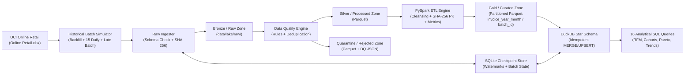
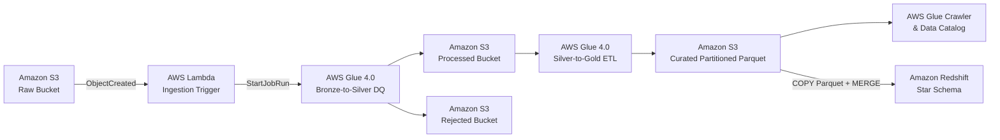

# System Architecture

## Overview

The **Retail Data Infrastructure & Analytics Platform** implements a Lakehouse-to-Warehouse architecture modeled after modern AWS data platforms while remaining 100% executable locally without cloud billing or external infrastructure dependencies.

## End-to-End Pipeline Architecture

## AWS Cloud-Ready Target Architecture

## Incremental Processing, Idempotency & Late-Arriving Data

1. **Batch & File Fingerprinting**: Every incoming CSV is fingerprinted with SHA-256. Re-ingesting an already-`LOADED` batch is skipped unless `--force` is passed.
2. **Partitioned Curated Lake**: PySpark writes curated transactions partitioned by `(invoice_year_month, batch_id)` with `spark.sql.sources.partitionOverwriteMode = dynamic`, ensuring forced reruns only replace that specific batch's partition slices.
3. **Monotonic Watermarking**: `CheckpointStore` tracks `high_watermark_ts` (`MAX(InvoiceDate)`). Late-arriving batches (`min_invoice_ts < high_watermark_ts`) are flagged `is_late_arriving = true`, backfilled into historical Parquet partitions and `analytics.fact_sales`, and update `dim_customer.first_purchase_ts = LEAST(...)` without regressing the high watermark.
4. **Warehouse Idempotency**: Every curated row receives a deterministic SHA-256 `transaction_line_id`. DuckDB loads use transactional `INSERT ... ON CONFLICT (transaction_line_id) DO UPDATE`, guaranteeing zero duplicate fact rows across retries or reruns.
