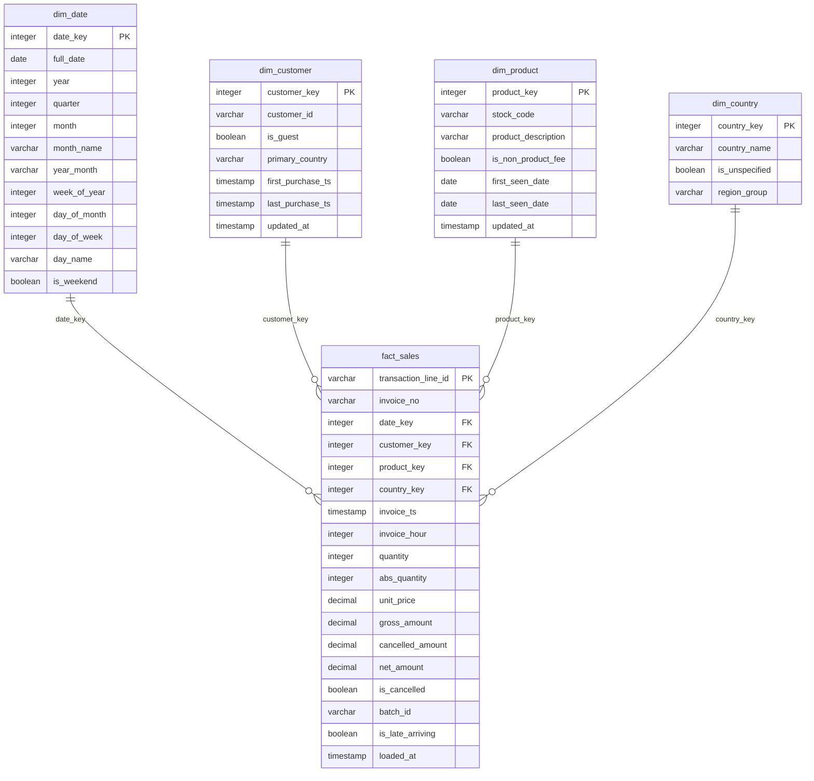

# Data Warehouse Dimensional Schema

## Overview

The local analytical warehouse runs on **DuckDB** (`data/warehouse/retail_warehouse.duckdb`) inside schema `analytics`, with a direct cloud counterpart in **Amazon Redshift** (`infrastructure/aws/redshift/01_create_schemas_and_tables.sql`).

## Star Schema Entity-Relationship Diagram

## Table Grain & Design Decisions

| Table | Grain | Primary Key | Design Notes |
| --- | --- | --- | --- |
| `analytics.fact_sales` | One validated invoice line item | `transaction_line_id` (SHA-256) | Retains both positive sales (`is_cancelled = false`) and credit cancellations (`is_cancelled = true`) so net, gross, and cancellation metrics reconcile cleanly. |
| `analytics.dim_customer` | One distinct `customer_id` (+ `-1` for `GUEST`) | `customer_key` (INTEGER) | ~24.9% of raw UCI transactions lack `CustomerID`. Mapping them to `customer_key = -1` preserves total store revenue while letting customer RFM/CLV queries filter `NOT is_guest`. |
| `analytics.dim_product` | One distinct `stock_code` | `product_key` (INTEGER) | Flags non-merchandise service codes (`POST`, `D`, `M`, `BANK CHARGES`, `DOT`, `AMAZONFEE`, `CRUK`, `S`, `PADS`) via `is_non_product_fee`. |
| `analytics.dim_date` | One calendar day | `date_key` (`YYYYMMDD`) | Supports calendar, weekday/weekend, quarter, and cohort aggregations. |
| `analytics.dim_country` | One distinct country string | `country_key` (INTEGER) | Includes `region_group` classification and preserves `Unspecified` for audit completeness. |
| `analytics.etl_batch_audit` | One loaded batch | `batch_id` (VARCHAR) | Records batch lineage, row counts, `is_late_arriving` flag, and min/max timestamps. |
